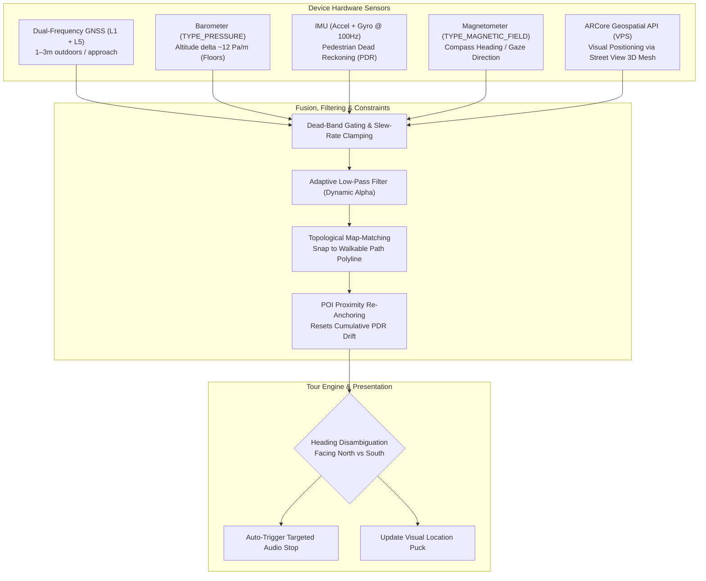
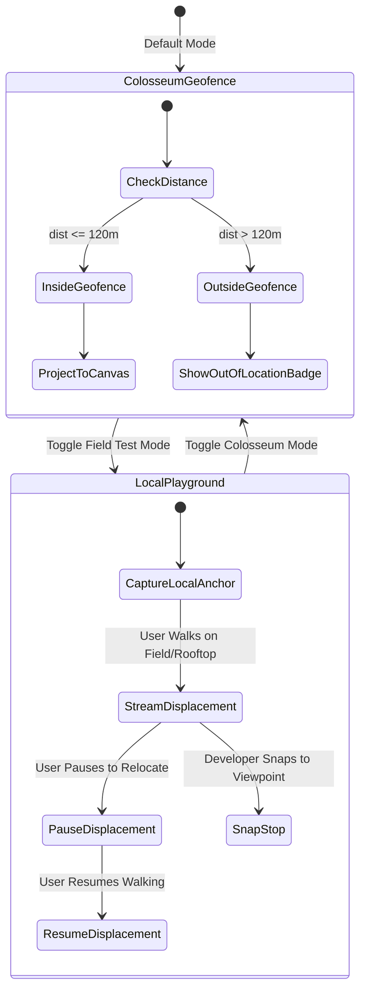
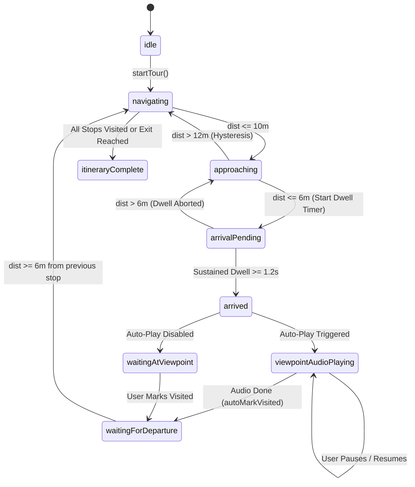
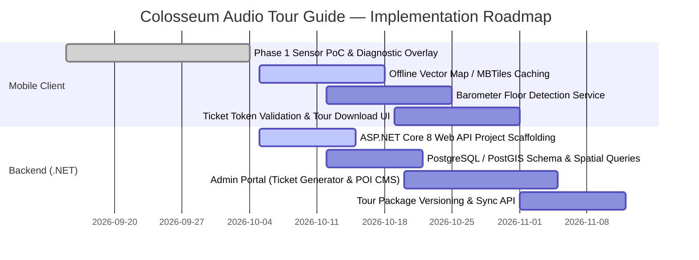

# Colosseum Audio Tour Guide — Master Architectural & Project Context

> **Document Type:** Master Architectural Specification, Codebase Blueprint & Project Context  
> **Target Audience:** Core Engineering Team, Mobile & Backend Developers, AI Coding Agents, System Architects  
> **Location:** Rome, Italy (`41.890210° N, 12.492231° E`) · UNESCO World Heritage Site  
> **Repository Root:** `/mnt/503ADFEC3ADFCD5A/code/Android/Colosseum`  
> **Mobile Client Root:** `project/ColosseumClient/`  
> **Backend Service Root:** `project/backend/`  
> **Last Updated:** October 2026

---

## 1. Executive Summary & Project Purpose

The **Colosseum Audio Tour Guide** is an offline-first, floor-aware, hands-free mobile application engineered to guide international tourists through the ancient Flavian Amphitheatre (Colosseum) in Rome, Italy.

### 1.1 Core Value Proposition & Operational Model
* **Ticket-Token Access (Zero User Friction):** Visitors receive a physical printed ticket or voucher bearing a unique alphanumeric token issued at the monument entrance or ticketing counter. Tourists open the app, enter the token, and immediately unlock the tour. **No personal account creation, email verification, or username/password authentication is required.**
* **100% Offline-First Execution:** Once a tour package (itineraries, viewpoints, floor plans, and narration audio) is downloaded, the entire visitor experience functions flawlessly with **zero cellular connectivity or Wi-Fi**. This is crucial inside the Colosseum, where ancient travertine walls up to 50 meters high and underground vaulted masonry block RF signals completely.
* **Hands-Free Walkthrough Narration:** Narration automatically triggers through the visitor's earphones as they approach configured Points of Interest (POIs) / Viewpoints floor by floor. The visitor keeps their phone in their pocket or hand without needing to stare at the screen continuously. Manual playback controls (play, pause, seek, replay) remain available at all times.
* **Floor-Aware Multilevel Navigation:** The Colosseum features four distinct historical levels accessible to visitors:
  1. **Underground (Hypogeum):** Subterranean service tunnels, animal cages, and Flavian/Severan elevator hoists.
  2. **Level 1 (Ground / Arena):** Monument entrances, vomitoria, pulvinar (imperial box), and cavea seating.
  3. **Level 2 (First Level):** Middle cavea, museum exhibition galleries, and panoramic archaeological terraces.
  4. **Level 3 (Second Level / Belvedere):** Upper ring galleries, Roman water cisterns, and monumental vistas.

---

## 2. Requirement Documents & Specification Analysis

The project requirements originate from three authoritative specification documents in the `requirement pdfs/` directory and two supplementary high-precision positioning guides in the repository root.

```
Colosseum/
├── requirement pdfs/
│   ├── Colosseum_Tour_Guide_Dev_Spec.pdf          # Baseline technical MVP specification
│   ├── backend dotnet - agile development.pdf     # Client change requests (.NET & Sprints)
│   └── Phase1-prototype_Sensor_PoC (1).pdf       # Phase 1 sensor PoC & risk gate
├── COLOSSEUM_POSITIONING_GUIDE_EN.md              # Centimeter-level positioning & survey guide
└── COLOSSEUM_POSITIONING_GUIDE_BN.md              # Bengali translation of positioning guide
```

---

### 2.1 Baseline Technical Specification (`Colosseum_Tour_Guide_Dev_Spec.pdf`)

Authored as an internal engineering reference by *hakaluki.dev*, this document defines the MVP scope and architectural baseline:
1. **Visitor Journey:**
   $$\text{Receive Ticket Token} \longrightarrow \text{Enter Token in App} \longrightarrow \text{Download Tour Package} \longrightarrow \text{Confirm Entry} \longrightarrow \text{Hands-Free Audio Walkthrough}$$
2. **Administrative Portal & CMS Requirements:**
   * **Authentication:** Role-based secure admin sign-in.
   * **Ticket & Token Management:** Batch token generation, status monitoring (issued, active, expired), and printable voucher formats.
   * **Site & Floor Management:** Site metadata, floor plan layers, and boundary coordinates.
   * **POI Management:** Create/edit/reorder POIs per floor, attach audio narrations, images, and set trigger radii. The portal validates and flags missing coordinates, radii, or audio files before publishing.
   * **Route Management:** Define and reorder linear walking sequences across floors.
   * **Audio & Language Management:** Manage localized narrations and text across multiple languages (English, Italian, Spanish, French, German, etc.). Only complete language sets are published.
   * **Draft-and-Publish Workflow:** Versioned synchronization so mobile clients download only modified assets.
3. **Database & Infrastructure Baseline:**
   * Spatial database storing coordinates, floor plans, and geofences with PostGIS spatial indexing.
   * Object storage paired with a CDN for audio and image asset delivery.
   * Local mobile persistence using SQLite/Drift or encrypted local key-value stores.

---

### 2.2 Client Change Requests (`backend dotnet - agile development.pdf`)

Before commencing development, the client formally submitted two mandatory amendments to the technical proposal:

| Change Request | Domain | Client Rationale | Architectural & Operational Impact |
| :--- | :--- | :--- | :--- |
| **1. Sprint-Based Delivery with Client Review** | Process | Catch issues early; avoid backloaded UAT failures in the final week. | The project follows strict 2-week agile sprints. Each sprint concludes with a formal client demo and acceptance gate before proceeding to the next sprint. |
| **2. Backend Stack: .NET Core instead of Next.js** | Architecture | The client's internal IT team is exclusively a **.NET shop**. After delivery and warranty handover, their internal team will manage maintenance and extensions. Maintaining Next.js would require costly external hiring. | **Replace the proposed Next.js API layer with ASP.NET Core 8 Web API.** The admin portal UI can remain React/Next.js or Blazor, but all API endpoints, business logic, ticket validation, and spatial queries must reside in .NET running on Linux VPS via Kestrel. |

---

### 2.3 Phase 1 Sensor & Prototype PoC (`Phase1-prototype_Sensor_PoC (1).pdf`)

Because indoor positioning under ancient stone architecture without hardware beacons is the highest-risk technical element, the client established a **2-week Proof of Concept (PoC)** risk gate before releasing the full 8-week MVP budget:

* **PoC Objectives:** Prove indoor floor detection and POI proximity triggering using smartphone sensors alone (barometer, accelerometer, gyroscope, magnetometer, GNSS), without dedicated Bluetooth Low Energy (BLE) beacons.
* **Target Device Matrix:**
  * *High-End iOS:* iPhone 14 / 15 / 16 (baseline gold standard sensors).
  * *Mid-Range iOS:* iPhone 12 / SE 3rd Gen (older barometer/gyro response).
  * *High-End Android:* Samsung Galaxy S23/S24, Google Pixel 8 (state-of-the-art Android sensor fusion).
  * *Mid-Range Android:* Samsung Galaxy A-series, Xiaomi Redmi (dominant tourist demographic).
  * *Budget Devices without Barometer:* Graceful fallback to manual floor selection or GPS/network bounds.
* **Remote Field Testing Architecture:**
  * **Local Proxy in Bangladesh:** The development team is located in Dhaka, Bangladesh. A local multi-story building with stairwells serves as the proxy testing ground for barometric altitude deltas and walking step counts.
  * **On-Site Testing in Rome:** Client and trusted local partners test walking routes directly inside the Colosseum while the app logs real sensor streams.
  * **Telemetry & Crash Reporting:** Remote logging via Firebase Crashlytics / Sentry to track sensor drift, false triggers, and detection accuracy.
* **Quantitative Decision Gate Criteria:**
  * **Floor Detection Accuracy:** $\ge 90\%$ correct floor identification across test walks.
  * **POI Proximity Triggering:** Audio triggers within $3\text{--}5\text{ meters}$ of the viewpoint $\ge 85\%$ of the time.
  * **False Trigger Rate:** $< 1$ false trigger per 15-minute tour session.
  * **Barometer Drift:** Measured over 60 minutes with validated POI re-anchor reset strategy.
  * **Battery Consumption:** Acceptable drain for a typical $60\text{--}90\text{ minute}$ tour.
  * **Decision Outcomes:** **GO** (proceed to 8-week full MVP), **ADJUST** (add BLE beacons or reduce indoor scope), or **NO-GO** (halt project before major capital expenditure).

---

### 2.4 High-Precision Positioning & Site Survey Architecture (`COLOSSEUM_POSITIONING_GUIDE_EN.md`)

When audio viewpoints are situated only **$2\text{--}3\text{ meters}$ apart**, standard GNSS ($6\text{--}15\text{m}$ error) cannot distinguish between adjacent viewpoints. The positioning guide establishes why naive sensor logging fails and details the hybrid solution:



* **Heading-Based Viewpoint Disambiguation:** When two viewpoints are $2\text{ meters}$ apart, coordinate proximity alone creates ambiguity. The app checks user orientation (gaze direction). If facing North toward the Arena, Viewpoint A triggers; if pivoted South toward the Hypogeum corridor, Viewpoint B triggers.
* **Topological Map Matching:** Tourists cannot walk through ancient Roman brick walls or fall into open pits. Estimated positions are mathematically snapped to valid walkable graph segments.
* **POI Re-Anchoring:** PDR naturally accumulates drift ($5\text{--}10\%$ of distance walked). Each confirmed arrival at a known POI resets cumulative spatial error to zero.

---

## 3. Technology Stack & Architectural Matrix

| Component | Selected Technology | Version / Spec | Justification & Architectural Role |
| :--- | :--- | :--- | :--- |
| **Mobile Framework** | **Flutter** (Dart SDK) | `^3.13.1` (Dart 3.x) | Single cross-platform codebase for Android and iOS with native 60+ FPS rendering performance. |
| **State Management** | **GetX Pattern** | `^4.7.3` | Clean architectural separation (Views, Controllers, Bindings, Services, Repositories). Reactive micro-updates without full widget tree rebuilds. |
| **Mapping Engine** | **flutter_map** + **latlong2** | `^7.0.2` / `^0.9.1` | High-performance, offline-capable Leaflet-style raster and vector map renderer. Renders crisp Google Maps Satellite tiles (`lyrs=s`), custom floor plans, and guided itinerary polylines. |
| **Orientation / Compass** | **flutter_compass** | `^0.8.1` | Real-time device magnetometer and gyro orientation streams with custom dead-band filtering and map-north rotation. |
| **Geolocation / GPS** | **geolocator** | `^14.1.1` | Device GNSS location streaming with custom 1-second interval tuning, geofence validation, and simulated local playground projection. |
| **Voice / Speech Engine** | **flutter_tts** | `^4.2.2` | High-performance on-device Text-to-Speech engine supporting multi-language speech, utterance generation synchronization, and character-level progress streaming. |
| **Local Persistence** | **shared_preferences** | `^2.5.5` | Lightweight, fast key-value persistence for tracking visited viewpoint IDs and user preferences across app restarts. |
| **Backend API (Target)** | **ASP.NET Core 8 Web API** | `.NET 8.0` / C# | Fulfills client requirement. High throughput, enterprise maintainability, and clean dependency injection on Linux Kestrel. |
| **Spatial Database** | **PostgreSQL + PostGIS** | `PostgreSQL 16` | Relational storage with spatial indices (`ST_DWithin`, `ST_Point`) for geofencing, POIs, tickets, and versioned tour packages. |
| **Local Offline DB (Future)** | **Drift / SQLite** | Dart SQLite | Structured client-side storage for cached offline map tiles, audio blobs, and tour sync packages. |

---

## 4. Codebase Architecture (`ColosseumClient`)

The mobile client strictly implements the **GetX Pattern** with clean separation between presentation, state controllers, domain services, and data providers.

### 4.1 Detailed Directory & File Structure

```
project/ColosseumClient/
├── android/
│   ├── app/
│   │   ├── build.gradle.kts                   # Android build script (compileSdk=34, targetSdk=34)
│   │   └── src/main/AndroidManifest.xml       # Location, compass & audio permissions
│   ├── colosseum-release-key.jks              # RSA-2048 production signing keystore
│   ├── key.properties                         # Keystore credentials (git-ignored)
│   └── build.gradle.kts                       # Root Gradle configuration
│
├── assets/
│   ├── icons/                                 # App navigation & category icons
│   ├── images/                                # Historical photos & diagrams for 28 viewpoints
│   └── logo/                                  # Colosseum branding assets
│
├── lib/
│   ├── main.dart                              # Application entry point & service bootstrap
│   │
│   ├── app/
│   │   ├── core/
│   │   │   ├── constants/
│   │   │   │   └── app_assets.dart            # Centralized asset string constants
│   │   │   ├── theme/                         # Single source of truth design tokens
│   │   │   │   ├── app_colors.dart            # Semantic color palette (primary, card, borders)
│   │   │   │   ├── app_radius.dart            # Border radius tokens (sm: 6, md: 8, lg: 10, xl: 14)
│   │   │   │   ├── app_theme.dart             # Complete Light ThemeData configuration
│   │   │   │   └── theme_extensions.dart      # context.colors & Get.colors helper extensions
│   │   │   └── utils/
│   │   │       └── geodesic_utils.dart        # Ellipse math, bounds & WGS84-to-canvas coordinate transforms
│   │   │
│   │   ├── data/
│   │   │   ├── models/
│   │   │   │   ├── floor_model.dart           # Floor metadata, viewpoint counts & progress
│   │   │   │   ├── itinerary_segment_model.dart # Walking route segments connecting stops
│   │   │   │   ├── poi_model.dart             # Landmark & architectural overlay model
│   │   │   │   ├── tour_navigation_state.dart # Central state machine model & TourConfig
│   │   │   │   ├── user_location_model.dart   # Live coordinates (normalized + WGS84 + heading)
│   │   │   │   ├── user_orientation_state.dart# Filtered compass heading & calibration state
│   │   │   │   └── viewpoint_model.dart       # Complete audio stop model (order, coords, text, audio)
│   │   │   │
│   │   │   ├── providers/
│   │   │   │   └── colosseum_tour_data.dart   # All 28 authentic viewpoints & itineraries across 4 levels
│   │   │   │
│   │   │   └── services/
│   │   │       ├── compass_service.dart       # Dead-band noise filter, adaptive alpha & map-north offset
│   │   │       ├── gps_location_service.dart  # Colosseum geofence & local playground field-test modes
│   │   │       ├── tour_navigation_engine.dart# Proximity detection, arrival dwell, auto-play & hysteresis
│   │   │       ├── tts_service.dart           # Dual-mode speech (instructions vs narrations)
│   │   │       └── visited_viewpoints_service.dart # Persistent SharedPreferences visited stop sync
│   │   │
│   │   ├── modules/
│   │   │   ├── splash/                        # Branded launch screen
│   │   │   │   ├── bindings/splash_binding.dart
│   │   │   │   ├── controllers/splash_controller.dart
│   │   │   │   └── views/splash_view.dart
│   │   │   │
│   │   │   ├── language/                      # Language selection screen
│   │   │   │   ├── bindings/language_binding.dart
│   │   │   │   ├── controllers/language_controller.dart
│   │   │   │   ├── views/language_view.dart
│   │   │   │   └── widgets/language_tile.dart
│   │   │   │
│   │   │   ├── home/                          # Landmark overview & city-scale map
│   │   │   │   ├── bindings/home_binding.dart
│   │   │   │   ├── controllers/home_controller.dart
│   │   │   │   ├── views/home_view.dart
│   │   │   │   └── widgets/map_marker_widget.dart
│   │   │   │
│   │   │   ├── floors/                        # Multilevel Colosseum floor selection
│   │   │   │   ├── bindings/floors_binding.dart
│   │   │   │   ├── controllers/floors_controller.dart
│   │   │   │   ├── views/floors_view.dart
│   │   │   │   └── widgets/floor_card.dart
│   │   │   │
│   │   │   └── floor_map/                     # Interactive guided tour map & guide player
│   │   │       ├── bindings/floor_map_binding.dart
│   │   │       ├── controllers/floor_map_controller.dart
│   │   │       ├── views/floor_map_view.dart
│   │   │       └── widgets/
│   │   │           ├── entry_exit_marker.dart
│   │   │           ├── floor_plan_painter.dart
│   │   │           ├── itinerary_painter.dart
│   │   │           ├── route_painter.dart
│   │   │           ├── user_location_puck.dart
│   │   │           ├── viewpoint_detail_card.dart
│   │   │           └── viewpoint_marker.dart
│   │   │
│   │   └── routes/
│   │       ├── app_pages.dart                 # Route definitions & GetPage mappings
│   │       └── app_routes.dart                # Route string constants
│   │
│   └── test/                                  # 115 passing unit and widget tests
│       ├── helpers/
│       ├── unit/
│       └── widget/
│
└── ai/
    ├── rules.md                               # Architectural rules & coding standards
    ├── pipeline.md                            # Release compilation & signing pipeline
    └── context.md                             # Master project context (this file)
```

---

## 5. Mathematical & Engineering Deep Dive

### 5.1 Geodesic Math & Coordinate Systems (`geodesic_utils.dart`)

The Colosseum is an elliptical structure oriented along a rotated major axis. To render satellite imagery, floor plans, user beacons, and POIs accurately, the app maintains an analytical coordinate transformation between WGS84 geographic coordinates ($\text{Latitude}, \text{Longitude}$) and normalized 2D canvas coordinates ($[0.0, 1.0] \times [0.0, 1.0]$).

#### Monument Geodetic Constants:
* **Center Coordinate:** $\text{Lat}_0 = 41.890210^\circ\text{ N}, \; \text{Lng}_0 = 12.492231^\circ\text{ E}$
* **Arena Dimensions:** Width $= 86.0\text{ meters}$, Height $= 54.0\text{ meters}$
* **Monument Rotation Angle:** $\theta = -20.0^\circ$ (the Colosseum's major axis is rotated $20^\circ$ clockwise from East-West)
* **Earth Radius Approximation:**
  $$\text{metersPerDegreeLat} = 111,139.0\text{ m/deg}$$
  $$\text{metersPerDegreeLng} = 111,139.0 \times \cos(\text{Lat}_0 \times \frac{\pi}{180}) \approx 82,752.6\text{ m/deg}$$

#### Coordinate Forward Projection ($\text{LatLng} \to \text{Canvas Offset}$):
Given a geographic coordinate $(\phi, \lambda)$:
1. Calculate East/North metric displacements from center:
   $$\Delta N = (\phi - \text{Lat}_0) \times \text{metersPerDegreeLat}$$
   $$\Delta E = (\lambda - \text{Lng}_0) \times \text{metersPerDegreeLng}$$
2. De-rotate displacements into monument-aligned Cartesian frame ($\theta = -20^\circ$):
   $$x_{\text{rot}} = \Delta E \cos(\theta) - \Delta N \sin(\theta)$$
   $$y_{\text{rot}} = \Delta E \sin(\theta) + \Delta N \cos(\theta)$$
3. Map metric offsets to normalized canvas space centered at $(0.50, 0.50)$:
   $$X_{\text{norm}} = 0.50 + \left(\frac{x_{\text{rot}}}{\text{arenaWidth}}\right) \times 0.82$$
   $$Y_{\text{norm}} = 0.50 - \left(\frac{y_{\text{rot}}}{\text{arenaHeight}}\right) \times 0.60$$

---

### 5.2 Dual-Mode GPS & Local Playground Engine (`gps_location_service.dart`)

Developing an indoor/outdoor navigation app in Bangladesh for a monument situated in Rome presents a major physical testing challenge. The `GpsLocationService` implements two distinct operational modes:



1. **Colosseum Geofence Mode (Rome On-Site):**
   * Uses real GPS fixes. Measures Euclidean distance to $\text{ColosseumCenter}$.
   * If $\text{distance} \le 120\text{ meters}$, `isInLocation = true` and coordinates project onto the floor plan canvas.
   * If $\text{distance} > 120\text{ meters}$, user puck is hidden and the "You are not in the location" badge appears.
2. **Local Playground Field-Test Mode (Bangladesh Remote Testing):**
   * Anchors the user's real physical ground location (e.g. an open park, cricket field, or office rooftop in Dhaka) to a virtual anchor on the Colosseum floor plan (defaults to `ENTRY` at $(0.92, 0.50)$).
   * As the developer walks physically in Bangladesh, metric displacements ($\Delta E, \Delta N$) are projected onto the Colosseum map in real time.
   * **Displacement Pause & Resume (Relocation Re-Anchoring):** If the developer runs out of physical walking space (e.g. reaches a wall in Dhaka), they tap **Pause**. The map puck freezes. The developer walks physically to the other side of the room, taps **Resume**, and continues walking without distorting their tour route.
   * **Developer Simulation Tools:**
     * **Snap Stop:** Snaps user coordinates directly onto the current or selected viewpoint stop, bypassing GPS noise and triggering instant arrival verification.
     * **Tap-to-Place (FoodPanda / Uber Style):** Tapping anywhere on the satellite map sets a simulated user coordinate, pauses displacement, and evaluates tour engine proximity immediately.

---

### 5.3 Sensor Orientation & Compass Filtering Engine (`compass_service.dart`)

Raw smartphone magnetometers produce continuous micro-jitter ($\pm 3^\circ\text{--}8^\circ$) when stationary and suffer from erratic electromagnetic interference spikes. `CompassService` implements an industrial-grade filtering pipeline:

1. **Dead-Band Noise Gating:** Angular fluctuations smaller than $1.5^\circ$ are treated as sensor electronic noise and suppressed while stationary:
   $$\text{If } |\Delta\theta| < 1.5^\circ \implies \theta_t = \theta_{t-1}$$
2. **Slew-Rate Clamping:** Electromagnetic spikes (e.g. walking near iron railings or electrical conduit) are clamped to a maximum physical rotation speed of $360^\circ/\text{second}$.
3. **Adaptive Low-Pass Smoothing (Dynamic $\alpha$):**
   * Stationary or slow head turns: $\alpha \approx 0.08$ (maximum smoothing, zero jitter).
   * Fast, deliberate device turns: $\alpha \to 0.65$ (instant responsiveness, zero lag).
4. **Boundary-Safe Circular Interpolation:** Accurately interpolates shortest angular path across the $359^\circ \leftrightarrow 0^\circ$ wrap-around boundary.
5. **Map-North Coordinate Transformation:** Offsets true heading by $-20.0^\circ$ so the orientation cone projects accurately relative to the Colosseum's rotated architectural axis.

---

### 5.4 Indoor Tour Navigation State Machine (`tour_navigation_engine.dart`)

The tour guide is governed by a state machine that controls proximity detection, dwell verification, hysteresis, audio auto-play, and sequential stop advancement:



#### Tour Zones & Thresholds (`TourConfig`):
* **Approach Zone:** Distance $\le 10.0\text{ meters}$. Announces: *"Viewpoint X is ahead."* (latched to speak only once per stop).
* **Approach Hysteresis:** Distance must exceed $12.0\text{ meters}$ ($10\text{m} + 2\text{m}$) before the approaching state is cleared.
* **Arrival Zone:** Distance $\le 6.0\text{ meters}$.
* **Arrival Dwell Timer:** Requires sustained presence inside $\le 6.0\text{m}$ for **$1.2\text{ seconds}$** before confirming arrival. Prevents false triggers from GPS drift or someone walking briskly past a viewpoint. (Bypassed during developer simulation / snap stop).
* **Departure Hysteresis:** Distance from previous stop must reach $\ge 6.0\text{ meters}$ before the engine re-arms proximity auto-play for the next stop.
* **Audio-Play Decoupling:** Spoken navigation instructions (e.g. *"Next, proceed toward Viewpoint 101"*) are completely decoupled from viewpoint historical narrations to prevent speech collisions.

---

### 5.5 Dual-Mode Text-to-Speech Engine (`tts_service.dart`)

The audio guide distinguishes between two distinct categories of speech:
1. **Navigation Voice Instructions (`speakInstruction`):** Short navigational guidance cues (e.g. *"You have arrived at Viewpoint 100"*, *"Proceed toward the Exit"*). Handled with a safety fallback timer ($3000\text{--}7000\text{ms}$) to guarantee completion callbacks execute even if native Android/iOS TTS engines drop hardware completion events.
2. **Viewpoint Historical Narration (`speakNarration`):** In-depth audio guide content ($3\text{--}6\text{ minutes}$ per stop). Streams character offset updates to calculate progress $(0.0\text{--}1.0)$ and invokes `onNarrationComplete` upon conclusion to automatically advance the tour.
3. **Generation Counter & Cancel Echo Isolation:** Every speech request increments an internal `_generation` counter. Asynchronous native cancellation events resulting from previous `stop()` calls are discarded so they cannot cancel subsequent speech requests.

---

## 6. Monument Tour Inventory & Content Architecture

All 28 authentic historical viewpoints and walking itineraries are codified in `ColosseumTourData` (`lib/app/data/providers/colosseum_tour_data.dart`), sourced from official *Parco archeologico del Colosseo* documentation:

### 6.1 Viewpoints Summary Table

| Level / Floor | Viewpoint IDs | Stops | Authentic Focus & Historical Highlights | Itinerary Segments |
| :--- | :--- | :--- | :--- | :--- |
| **Underground (Hypogeum)** | `vp_100` to `vp_106` | 7 Stops | Gladiatorial spectacles, Ludus Magnus tunnels, Fosso Labicano stream, Flavian perimeter hoists, Corridor H ramps, 217 CE fire modifications, 19th/20th-century excavations. | 8 Segments (Entry $\to 100 \dots 106 \to$ Exit) |
| **Level 1 (Ground / Arena)** | `vp_200` to `vp_208` | 9 Stops | Northern Imperial Entrance (Arch 38), crowd-control numbering, vomitoria circulation, arena floor overview, senatorial marble *loca*, Imperial box (*pulvinar*), Knights' seating. | 10 Segments (Entry $\to 200 \dots 208 \to$ Exit) |
| **Level 2 (First Level)** | `vp_300` to `vp_306` | 7 Stops | Cavea panorama, *maenianum secundum*, panoramic terrace over Roman Forum, museum exhibitions (sculptural decorations, medieval adaptations), Lucangeli wooden model. | 8 Segments (Entry $\to 300 \dots 306 \to$ Exit) |
| **Level 3 (Belvedere)** | `vp_400` to `vp_404` | 5 Stops | Intermediate gallery, Roman hydraulic water management, ancient red epigraphic graffiti (*tituli picti*), upper wooden bleachers, panoramic city belvedere. | 6 Segments (Entry $\to 400 \dots 404 \to$ Exit) |
| **Total** | **4 Levels** | **28 Stops** | **Comprehensive Flavian Architectural & Cultural Walkthrough** | **32 Segments** |

---

## 7. Current Project Status & Recent Improvements

### 7.1 Automated Verification & Test Coverage
* **Unit & Widget Test Suite:** **115 passing tests** across `test/unit/` and `test/widget/` covering controllers, navigation state machine, compass filters, GPS calculations, and UI components.
* **Static Code Analysis:** **0 errors, 0 warnings, 0 lints** via `flutter analyze`.

### 7.2 Recent Uncommitted Refinements (Working Tree)
The local repository contains high-value optimizations awaiting staging:
1. **TTS Utterance Synchronization:** Added generation counters and `_awaitingNativeStart` gating to `TtsService` to eliminate race conditions between previous cancellation echoes and new narration starts.
2. **Progress Timer Lifecycle:** Synchronized narration progress timers in `FloorMapController` directly to native audio playback start events.
3. **Async Snapping & Simulation:** Made `snapToTarget()` and `setSimulatedLocation()` asynchronous, cleanly halting active speech before moving the user location beacon.
4. **Departure Hysteresis Gate:** Suppressed departure prompt evaluation during simulated jumps to prevent speech collisions with instant arrival announcements.
5. **Progress Bar Safety Clamping:** Clamped progress values to $[0.0, 1.0]$ in `ViewpointDetailCard` to prevent render overflow exceptions.

---

## 8. Implementation Roadmap & Gap Analysis (Path to MVP)



### 8.1 Completed Capabilities
- [x] Full 4-level data model with 28 authentic viewpoints and guided itineraries.
- [x] Geodesic math engine converting WGS84 coordinates to rotated monument canvas offsets.
- [x] Dual-mode GPS service with Colosseum geofencing and local playground field-test displacement.
- [x] Compass service with dead-band noise gating, adaptive smoothing, and map-north correction.
- [x] Tour navigation engine with proximity zones, dwell timers, departure hysteresis, and auto-play.
- [x] Dual-mode Text-to-Speech service for navigation directions and viewpoint narrations.
- [x] Visited viewpoints persistence across app sessions via `SharedPreferences`.
- [x] Clean GetX architecture with 115 passing tests and 0 analysis lints.

### 8.2 Remaining Mobile Capabilities (To Build)
1. **Offline Map MBTiles / Caching:** Package and bundle offline raster/vector tiles into the client so Google Satellite tiles render without internet access.
2. **Barometer Floor Detection Service:** Implement continuous `SensorMethod.PRESSURE` sampling, entry baseline calibration, and $\approx 12\text{ Pa/m}$ delta calculation for automated floor switching.
3. **Ticket Token Validation Module:** Build the UI view and controller for entering printed ticket tokens, verifying against the backend API when online, and caching validity locally.
4. **Tour Package Download Manager:** Resumable chunked downloading of audio files, high-res images, and floor plans with download progress bars.

### 8.3 Remaining Backend Capabilities (To Build)
1. **ASP.NET Core 8 Web API Scaffolding:** Create `project/backend/ColosseumApi` using .NET 8, Entity Framework Core, and Kestrel.
2. **PostgreSQL / PostGIS Spatial Database:** Establish migrations for `Tickets`, `Floors`, `Viewpoints`, `Itineraries`, `Languages`, and `MediaAssets`.
3. **Administrative Web Portal:** Build the CMS interface for issuing tickets, updating viewpoint coordinates/radii, uploading audio narration files, and publishing changes.
4. **Versioned Synchronization Endpoint (`/api/v1/tour/sync`):** Deliver incremental JSON sync packages so mobile clients only download modified assets.

---

## 9. Developer Guidelines & Operating Reference

### 9.1 Quality Gates & Verification
Before committing code or submitting pull requests, developers must execute the following commands in `project/ColosseumClient`:

```bash
cd project/ColosseumClient

# 1. Update dependencies
flutter pub get

# 2. Strict static analysis (must report 0 issues)
flutter analyze

# 3. Complete regression test suite (all 115+ tests must pass)
flutter test
```

### 9.2 Release Compilation Rules (Universal Fat APK)
Per [`ai/rules.md`](file:///mnt/503ADFEC3ADFCD5A/code/Android/Colosseum/project/ColosseumClient/ai/rules.md) and [`ai/pipeline.md`](file:///mnt/503ADFEC3ADFCD5A/code/Android/Colosseum/project/ColosseumClient/ai/pipeline.md):

> [!IMPORTANT]
> **Always compile Universal (Fat) APKs for on-site client delivery and visitor sideloading.**
> Never compile with `--split-per-abi` for direct handovers. Split APKs fail on 32-bit (`armeabi-v7a`) or rental devices with fatal `INSTALL_FAILED_NO_MATCHING_ABIS`.

```bash
cd project/ColosseumClient

# Universal Release APK Compilation
flutter clean
flutter pub get
flutter build apk --release --no-tree-shake-icons
```
* **Output Path:** `project/ColosseumClient/build/app/outputs/flutter-apk/app-release.apk`
* **Supported ABIs:** `arm64-v8a`, `armeabi-v7a`, `x86_64` (Universal compatibility).

### 9.3 Key Architectural Rules
* **UI Styling Single Source of Truth:** Never hardcode raw hex colors or numbers in widgets. Always use `context.colors.<token>` and `AppRadius.<token>` defined in `lib/app/core/theme/`.
* **State Safety:** Keep widgets stateless (`GetView<Controller>`). Manage state in controllers via `.obs` and wrap reactive UI blocks in granular `Obx(() => ...)`.
* **Resource Cleanup:** Always dispose subscriptions, timers, and native listeners in `onClose()`.
* **Testing:** Maintain comprehensive unit tests for all controllers and services under `test/unit/` and widget tests under `test/widget/`.
