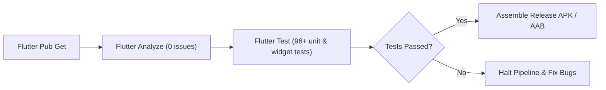
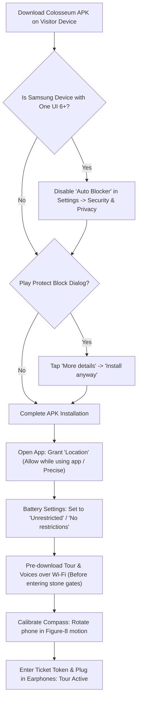

# Colosseum Audio Tour Guide — Build, Release & Delivery Pipeline Reference

> **Document Purpose:** Complete, step-by-step authoritative reference for compiling, signing, testing, and delivering production-ready Universal release APKs (and App Bundles) for the **Colosseum Audio Tour Guide Client** (`ColosseumClient`), along with keystore provisioning, artifact distribution, and on-site visitor hardware/OS onboarding and troubleshooting.

---

## 1. Release Build Architecture Overview

```
Colosseum/
├── requirement pdfs/                      # Client specs, dev spec, sensor PoC documentation
├── project/
│   ├── ColosseumClient/                   # Flutter client (GetX, Offline-First, Sensor-Fused Navigation)
│   │   ├── android/
│   │   │   ├── app/
│   │   │   │   ├── build.gradle.kts       # compileSdk = 34, targetSdk = 34, release signing config
│   │   │   │   └── key.properties         # Local signing credentials (git-ignored)
│   │   │   ├── colosseum-release-key.jks  # Production RSA-2048 release keystore
│   │   │   └── build.gradle.kts           # Root Gradle build script
│   │   ├── lib/                           # GetX Architecture (core, data, modules, routes)
│   │   ├── test/                          # Unit and widget test suite (96+ automated tests)
│   │   ├── pubspec.yaml                   # App version, assets, and dependencies
│   │   └── ai/
│   │       ├── rules.md                   # Architecture & styling guidelines
│   │       └── pipeline.md                # Build, release & delivery pipeline reference (this file)
│   │
│   ├── backend/                           # Next.js + TypeScript + PostgreSQL/PostGIS (Admin & Tickets)
│   │   └── readme.md
│   │
│   └── release_apks/                      # Distribution directory containing signed release APKs
│       ├── colosseum-guide-v1.0.0-universal-release.apk
│       └── SHA256SUMS.txt
```

---

## 2. Signing & Keystore Configurations

The mobile client must be signed with a dedicated, persistent RSA-2048 keystore (never the default ephemeral `debug.keystore`). Sideloading updates or releasing production builds signed with different keys causes fatal `INSTALL_FAILED_UPDATE_INCOMPATIBLE` collisions on visitor devices.

### 2.1. Keystore Specifications

| Parameter | Specification | Notes |
| :--- | :--- | :--- |
| **Keystore File** | `project/ColosseumClient/android/colosseum-release-key.jks` | Kept secure; never committed to public VCS |
| **Key Alias** | `colosseumkey` | Unique key alias in keystore |
| **Store Password** | `Colosseum2026Secure!` *(Configurable via `key.properties`)* | Min 8 chars alphanumeric |
| **Key Password** | `Colosseum2026Secure!` *(Configurable via `key.properties`)* | Matches or differs from store password |
| **Algorithm** | RSA 2048-bit | Industry standard for Android V2/V3 signing |
| **Validity** | 10,000 days (approx. 27 years) | Exceeds Google Play minimum requirement |
| **Distinguished Name** | `CN=Colosseum Tour, OU=Mobile, O=Hakaluki, L=Rome, C=IT` | Signer certificate identity |

---

### 2.2. Generating the Production Keystore

Execute the following command inside the `android/` directory of `ColosseumClient`:

```bash
cd /mnt/503ADFEC3ADFCD5A/code/Android/Colosseum/project/ColosseumClient/android

keytool -genkey -v \
  -keystore colosseum-release-key.jks \
  -alias colosseumkey \
  -keyalg RSA \
  -keysize 2048 \
  -validity 10000 \
  -storetype JKS \
  -dname "CN=Colosseum Tour, OU=Mobile, O=Hakaluki, L=Rome, C=IT" \
  -storepass "Colosseum2026Secure!" \
  -keypass "Colosseum2026Secure!"
```

---

### 2.3. Secure Gradle Properties Configuration (`key.properties`)

Create the credential mapping file at `project/ColosseumClient/android/key.properties`. This keeps private credentials decoupled from Gradle source code and version control:

```properties
# project/ColosseumClient/android/key.properties
storePassword=Colosseum2026Secure!
keyPassword=Colosseum2026Secure!
keyAlias=colosseumkey
storeFile=../colosseum-release-key.jks
```

> [!CAUTION]
> Add `android/key.properties` and `*.jks` to `project/ColosseumClient/.gitignore` to prevent leaking production signing keys.

---

### 2.4. Configuring `android/app/build.gradle.kts` for Production Signing

Update `project/ColosseumClient/android/app/build.gradle.kts` to load `key.properties` when building release variants:

```kotlin
import java.util.Properties
import java.io.FileInputStream

plugins {
    id("com.android.application")
    id("dev.flutter.flutter-gradle-plugin")
}

// Load signing properties if available
val keystoreProperties = Properties()
val keystorePropertiesFile = rootProject.file("key.properties")
if (keystorePropertiesFile.exists()) {
    keystoreProperties.load(FileInputStream(keystorePropertiesFile))
}

android {
    namespace = "com.example.colosseum_client"
    compileSdk = flutter.compileSdkVersion
    ndkVersion = flutter.ndkVersion

    compileOptions {
        sourceCompatibility = JavaVersion.VERSION_17
        targetCompatibility = JavaVersion.VERSION_17
    }

    defaultConfig {
        applicationId = "com.example.colosseum_client"
        minSdk = flutter.minSdkVersion
        targetSdk = flutter.targetSdkVersion
        versionCode = flutter.versionCode
        versionName = flutter.versionName
    }

    signingConfigs {
        create("release") {
            if (keystorePropertiesFile.exists()) {
                keyAlias = keystoreProperties["keyAlias"] as String
                keyPassword = keystoreProperties["keyPassword"] as String
                storeFile = file(keystoreProperties["storeFile"] as String)
                storePassword = keystoreProperties["storePassword"] as String
            } else {
                // Fallback for CI/local test builds if key.properties is not yet provisioned
                initWith(getByName("debug"))
            }
        }
    }

    buildTypes {
        release {
            signingConfig = signingConfigs.getByName("release")
            isMinifyEnabled = false
            isShrinkResources = false
            proguardFiles(
                getDefaultProguardFile("proguard-android-optimize.txt"),
                "proguard-rules.pro"
            )
        }
    }
}

kotlin {
    compilerOptions {
        jvmTarget = org.jetbrains.kotlin.gradle.dsl.JvmTarget.JVM_17
    }
}

flutter {
    source = "../.."
}
```

---

## 3. Pre-Build Quality Gates & Compilation

Always execute the automated verification test gates before initiating a release compilation.



### 3.1. Quality Gate Commands

```bash
cd /mnt/503ADFEC3ADFCD5A/code/Android/Colosseum/project/ColosseumClient

# 1. Ensure dependency tree matches pubspec.lock
flutter pub get

# 2. Strict static analysis check
flutter analyze

# 3. Complete unit & widget regression test suite
flutter test
```

---

### 3.2. Universal Release APK Compilation

> [!IMPORTANT]
> **Always generate Universal (Fat) APKs for on-site sideloading and customer delivery.**
> Never use `--split-per-abi` for visitor handovers or direct distribution. A split APK compiled for `arm64-v8a` fails on 32-bit (`armeabi-v7a`) devices, legacy tourist phones, or x86/x86_64 tablets with fatal `INSTALL_FAILED_NO_MATCHING_ABIS`.

Run the compilation command:

```bash
cd /mnt/503ADFEC3ADFCD5A/code/Android/Colosseum/project/ColosseumClient

# Clean previous build artifacts
flutter clean
flutter pub get

# Compile Universal Release APK
flutter build apk --release --no-tree-shake-icons
```

* **Build Output Path:** `project/ColosseumClient/build/app/outputs/flutter-apk/app-release.apk`
* **Architectures Included:** `arm64-v8a`, `armeabi-v7a`, `x86_64` (Universal compatibility).

---

### 3.3. Google Play Store Release (AAB) Compilation

For official Google Play Store submission:

```bash
cd /mnt/503ADFEC3ADFCD5A/code/Android/Colosseum/project/ColosseumClient
flutter build appbundle --release
```

* **Build Output Path:** `project/ColosseumClient/build/app/outputs/bundle/release/app-release.aab`

---

## 4. Distribution Artifacts Sync Script

To automate verification, compilation, artifact staging, and cryptographic checksum generation into the central `project/release_apks/` directory:

```bash
#!/usr/bin/env bash
# ==============================================================================
# Colosseum Audio Tour Guide — Build & Distribution Script
# Path: project/ColosseumClient/sync_release.sh
# ==============================================================================
set -euo pipefail

CLIENT_DIR="/mnt/503ADFEC3ADFCD5A/code/Android/Colosseum/project/ColosseumClient"
RELEASE_DIR="/mnt/503ADFEC3ADFCD5A/code/Android/Colosseum/project/release_apks"
VERSION=$(grep 'version: ' "${CLIENT_DIR}/pubspec.yaml" | awk '{print $2}' | cut -d'+' -f1)
BUILD_NUM=$(grep 'version: ' "${CLIENT_DIR}/pubspec.yaml" | awk '{print $2}' | cut -d'+' -f2)
TARGET_APK_NAME="colosseum-guide-v${VERSION}-${BUILD_NUM}-universal-release.apk"

echo "========================================================"
echo " Starting Colosseum Release Pipeline v${VERSION}+${BUILD_NUM}"
echo "========================================================"

cd "${CLIENT_DIR}"

# Step 1: Pre-flight Quality Assurance
echo ">> Running Flutter Analyze..."
flutter analyze

echo ">> Running Flutter Test Suite..."
flutter test

# Step 2: Clean & Compile Universal APK
echo ">> Building Universal Release APK..."
flutter clean
flutter pub get
flutter build apk --release --no-tree-shake-icons

# Step 3: Stage Distribution Artifact
echo ">> Syncing distribution artifact to ${RELEASE_DIR}..."
mkdir -p "${RELEASE_DIR}"
rm -f "${RELEASE_DIR}"/*.apk

cp "${CLIENT_DIR}/build/app/outputs/flutter-apk/app-release.apk" \
   "${RELEASE_DIR}/${TARGET_APK_NAME}"

# Step 4: Generate Checksums
cd "${RELEASE_DIR}"
sha256sum "${TARGET_APK_NAME}" > SHA256SUMS.txt

echo "========================================================"
echo " SUCCESS! Artifact deployed to:"
echo " ${RELEASE_DIR}/${TARGET_APK_NAME}"
echo " SHA256: $(cat SHA256SUMS.txt)"
echo "========================================================"
```

---

## 5. Visitor / Client Onboarding & Troubleshooting Guide (গ্রাহকদের জন্য ইনস্টলেশন ও অন-সাইট ব্যবহার নির্দেশিকা)

The Colosseum Audio Tour Guide operates in a challenging historical environment featuring thick ancient travertine stone walls, underground hypogeum tunnels, metal scaffolding, and high tourist density. Standard phone security settings and power managers can disrupt background location tracking, sensor fusion, and automated Text-to-Speech (TTS) narration.

### 5.1. Onboarding Workflow



---

### 5.2. Sideloading & Installation Unblocking

1. **Samsung One UI 6+ (Auto Blocker Block):**
   * Go to **Settings** $\rightarrow$ **Security and privacy** $\rightarrow$ **Auto Blocker**.
   * Turn the toggle **OFF** temporarily during installation.
2. **Google Play Protect ("Blocked by Play Protect - Unsafe app"):**
   * When the prompt appears, tap **"More details"** $\rightarrow$ **"Install anyway"**.
   * *(Note: This warning occurs for all non-Play Store sideloaded APKs).*
3. **Xiaomi / Redmi (MIUI & HyperOS Install Warnings):**
   * In the package installer security popup, select **"I am aware of the possible risks"** $\rightarrow$ check the countdown confirmation box $\rightarrow$ tap **OK**.

---

### 5.3. Permissions & System Hardware Calibration

1. **Precise Location Permission:**
   * When prompted, select **"While using the app"** (or **"Always"**).
   * Ensure **"Use precise location"** is toggled **ON**. Coarse location prevents POI proximity triggers ($\approx 5\text{m}$ radius).
2. **Battery Optimization Bypass (Crucial for Audio Narration):**
   * *Problem:* Android aggressive battery saving suspends GPS and compass polling when the phone screen is turned off or put in a pocket with earphones.
   * *Fix:* Open phone **Settings** $\rightarrow$ **Apps** $\rightarrow$ **Colosseum Tour Guide** $\rightarrow$ **Battery** $\rightarrow$ choose **"Unrestricted"** / **"No restrictions"**.
   * *Xiaomi / Vivo / Oppo:* Enable **"Autostart"** and set Battery Saver to **"No restrictions"**.
3. **Compass / Magnetometer Calibration (Travertine & Metal Interference):**
   * The Colosseum has extensive iron tie rods, modern steel railings, and reinforced pedestrian ramps that cause local magnetic distortions.
   * *Action:* If the orientation arrow on the floor plan map jitters or drifts, hold the phone flat and move it in a **figure-8 ($\infty$) motion** for 5 seconds to recalibrate the magnetometer.
4. **Offline Tour Preparation (Crucial for Hypogeum & Level 3):**
   * The underground **Hypogeum** and inner stone vaulted corridors have near-zero cellular signal (Faraday-like stone occlusion).
   * *Action:* Visitors must select their preferred language and confirm the tour download while connected to Wi-Fi at the entrance/visitor center or hotel before entering the monument.
5. **TTS Voice Engine Configuration:**
   * Narration relies on local Text-to-Speech (`flutter_tts`).
   * Verify that **Google Speech Services** (or the device's default TTS engine) has offline voice data downloaded for the chosen tour language (English, Italian, Spanish, French, German).
   * *Check:* Device **Settings** $\rightarrow$ **System** $\rightarrow$ **Languages & input** $\rightarrow$ **Text-to-speech output** $\rightarrow$ **Install voice data**.

---

## 6. Summary of Key File Locations

| Item | File Path |
| :--- | :--- |
| **Pipeline Reference** | `project/ColosseumClient/ai/pipeline.md` |
| **Architectural Rules** | `project/ColosseumClient/ai/rules.md` |
| **Flutter Source Root** | `project/ColosseumClient/lib/` |
| **Android App Gradle** | `project/ColosseumClient/android/app/build.gradle.kts` |
| **Release Keystore** | `project/ColosseumClient/android/colosseum-release-key.jks` |
| **Signing Credentials** | `project/ColosseumClient/android/key.properties` |
| **Output Universal APK** | `project/ColosseumClient/build/app/outputs/flutter-apk/app-release.apk` |
| **Release Staging Directory**| `project/release_apks/` |
